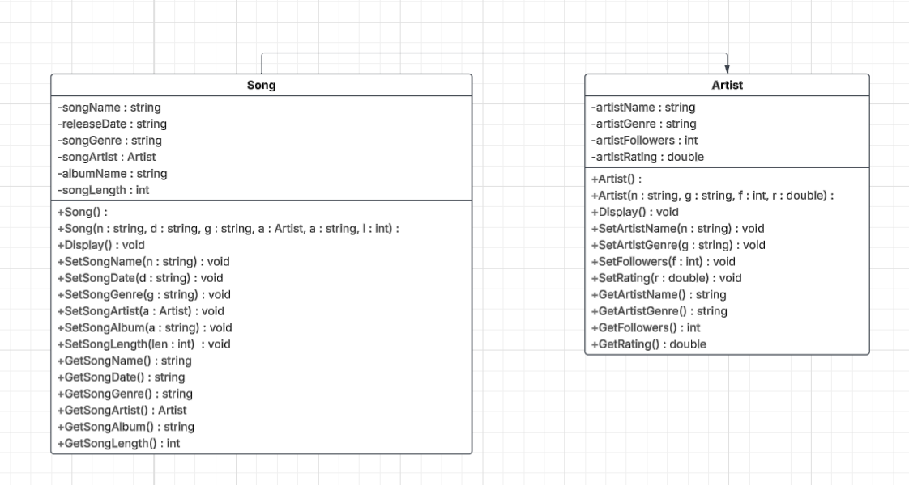
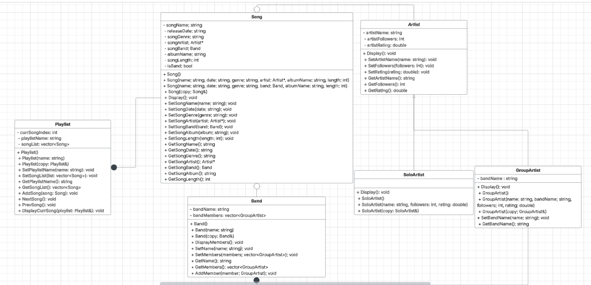
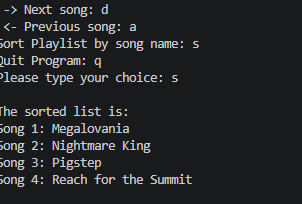

# Music Library
I want to make a program that acts as a playlist viewer. You will select a playlist, it will play (display details of) the song, and you can go to the next or previous track in the playlist.
# Additional Classes
- GroupArtist
- SoloArtist
- Band
- Playlist
## Requirements
- Identify at least one new class that will be a derived class, inheriting from another base class. Use public inheritance to extend functionality.
    - Both GroupArtist and SoloArtist inherit from the Artist class. This made it simple to have all the default variables (name, genre, etc.) in the base class and just build off of that.
- Ensure each class has a constructor and destructor. For classes involved in inheritance, ensure the constructor calls the base class constructor properly using an initializer list.
- Each new class should have a copy constructor. 
    - If this program were built upon more, users would be able to copy playlists and edit them. Copy constructors makes it much easier to copy each class.
- Implement at least one virtual function in a base class that can be overridden by a derived class, enabling runtime polymorphism.
    - The display function in both SoloArtist and GroupArtist overrides the base Display function in the Artist class. Since a GroupArtist will have different variables than a SoloArtist, it needs to display different things.
- Include private member variables and protected members if inheritance will be used, ensuring derived classes can access needed data.
- Add at least one friend function to a class, allowing external functions or other classes to access private members when necessary.
    - Playlist class contains a DisplayCurrSong function that is a friend function
- Making one of the new classes abstract by including at least one pure virtual function, which must be overridden by any derived class.
    - The Artist class Display function is virtual since the Display function will never be called unless it's being overriden in a child class.

### Old Diagram

### Updated Diagram

## Week 13 - Sorting Algorithm
- Vector: In the Playlist class, there is a vector that holds all the songs in that playlist.
### Task 2

The playlist is sorted alphabetically by the song titles.
### Task 3
1. I chose a bubble sort, simply because its one of the sorting methods that I've heard the most about. It's also one of the easier sorting algorithyms to learn and understand.
2. The best Time complexity is O(n), Average is O(n^2), and Worst is O(n^2). I expected it to work well with my dataset since it's only 4 entries long, meanining
3. The longer the list is, the worse the memory usage is. Bubble sort is known for being extremely inefficient while being easy to understand, which is much more clear in a bigger dataset.
4. Bubble sort is one of the easiest sorting algorithms to understand, but it is also extremely inneficient. I would recommend it to beginners to learn the idea of how sorting algorithms work, and wouldn't reccommend it for much else.
5. For the current playlists, it doesn't help much since they have so few entries. However, if someone were to make a playlist with more entries, it could be extremely helpful for them to find the song they're looking for since they simply have to scroll through the songs until they get to the letter they want.

Sources: 
https://www.geeksforgeeks.org/dsa/bubble-sort-algorithm/
https://www.geeksforgeeks.org/dsa/time-and-space-complexity-analysis-of-bubble-sort/

